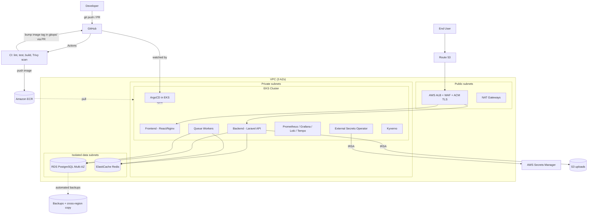

# Production-Ready Multi-Tier Platform on AWS EKS

> **Want to run this without paying for EKS?** See the [Lite edition](lite/README.md): the same
> chart and GitOps flow on one free-tier-eligible EC2 instance (k3s) or on your laptop (k3d),
> with in-cluster Postgres/Redis and GHCR instead of ECR.

A complete, GitOps-driven DevOps platform: Terraform-provisioned AWS infrastructure, Kubernetes on EKS, CI/CD with GitHub Actions + ArgoCD, full observability, and a security-first posture. The sample application (Laravel API + React frontend + PostgreSQL + Redis + queue workers) exists to give the platform something realistic to run.

> **Status:** All phases written (architecture, Terraform, Kubernetes/Helm, CI/CD + GitOps, monitoring, security, docs, chaos). **Not yet executed against a real AWS account**: see [Validation status](#validation-status) before you deploy.

---

## 1. What this project proves

| Skill area | Evidence in this repo |
|---|---|
| Infrastructure as Code | Reusable Terraform modules, remote state, per-environment composition |
| Kubernetes | HPA, PDB, NetworkPolicies, probes, requests/limits, Helm charts |
| CI/CD + GitOps | GitHub Actions (lint → test → build → scan → push) + ArgoCD promotion |
| Observability | Prometheus, Grafana, Loki, Tempo, Alertmanager, SLIs/SLOs |
| Security | Trivy, IRSA, External Secrets, Kyverno, Pod Security Standards |
| Reliability | Argo Rollouts canary, RDS backups, DR plan, runbooks, chaos tests |
| FinOps | Cost model, right-sizing notes, Spot/Graviton strategy |

---

## 2. Architecture



### Request flow
1. User hits `app.example.com` → Route 53 → ALB (TLS terminated with ACM, WAF attached).
2. ALB Ingress routes `/` to the frontend and `/api` to the Laravel API.
3. API reads/writes PostgreSQL (private data subnets), caches in Redis, and pushes slow work onto a Redis-backed queue.
4. Queue workers (separate Deployment, scaled on queue depth) consume jobs.

### Deployment flow (GitOps)
1. PR → CI runs lint, tests, builds images, runs Trivy; merge to `main` pushes images to ECR tagged with the git SHA.
2. CI opens a commit bumping the image tag in `gitops/environments/dev`.
3. ArgoCD syncs `dev` automatically; `staging` promotes via PR; `production` requires manual approval and deploys through an Argo Rollouts canary with automated analysis against Prometheus metrics.

### Environments

| Env | Cluster | Sync | Approval | Notes |
|---|---|---|---|---|
| dev | shared non-prod cluster, `dev` namespace | auto | none | cheap, Spot nodes |
| staging | shared non-prod cluster, `staging` namespace | auto on PR merge | PR review | prod-like config, smoke tests |
| production | dedicated cluster | manual sync | GitHub Environment approval | Multi-AZ, canary, PDBs |

Two clusters (non-prod and prod) is a deliberate trade-off between blast-radius isolation and cost. See ADR-003.

---

## 3. Application stack

- **Backend:** Laravel 11 (PHP 8.3), `/healthz`, `/readyz`, `/metrics` (Prometheus), JSON structured logs, OpenTelemetry tracing
- **Frontend:** React (Vite) served by Nginx
- **Database:** PostgreSQL 16 on RDS
- **Cache / queue:** Redis on ElastiCache (Laravel cache + queue driver)
- **Why Laravel:** it is the default backend here; swapping to Express only changes the `apps/backend` directory and Dockerfile, not the platform.

---

## 4. Repository layout

See [PROJECT_STRUCTURE.md](PROJECT_STRUCTURE.md) for the annotated tree. Top level:

```
apps/            Application source (backend, frontend)
terraform/       Infrastructure as Code (modules + environments + bootstrap)
helm/            Helm charts for the apps
gitops/          ArgoCD apps + per-environment values (the single source of truth)
monitoring/      Prometheus rules, Grafana dashboards, Loki/Tempo config, SLOs
security/        Kyverno policies, NetworkPolicies, PSS config
.github/         GitHub Actions workflows
docs/            ADRs, runbooks, DR plan, cost notes, interview prep
chaos/           Chaos Mesh experiments
scripts/         Helper scripts (bootstrap, teardown, smoke tests)
```

---

## 5. Deploy from zero

Full step-by-step guide with commands, timings and first-run troubleshooting: **[docs/deploy-from-zero.md](docs/deploy-from-zero.md)**
(GitHub variables and protections: [docs/github-setup.md](docs/github-setup.md)).

In short:

1. `terraform/bootstrap`: state bucket, lock table, GitHub OIDC roles (once per account).
2. `terraform/environments/<env>`: network, EKS, RDS, Redis, ECR, IAM (layer 1).
3. `terraform/addons/<env>`: ALB controller, External Secrets, ArgoCD, metrics-server (layer 2).
4. `scripts/configure.sh`: fill in account, domain, certificate and secret ARNs; push to Git.
5. CI builds, scans and pushes images, then bumps the dev image tag in Git.
6. `kubectl apply -f gitops/bootstrap/root-<env>.yaml`: the **only** manual apply. ArgoCD installs monitoring, logging, tracing, policies and the workloads from Git.
7. `scripts/smoke-test.sh`, open Grafana, promote through staging to production, watch the canary.

Teardown: `scripts/destroy.sh <nonprod|prod>` (removes ALBs and volumes first so Terraform does not hang).

---

## Validation status

This was written and reviewed without access to an AWS account, a cluster, or several tools. Be clear about what was and was not checked:

| Part | Checked | **Not** checked |
|---|---|---|
| Terraform (all stacks) | Syntax parses (HCL parser) | `validate`, `plan`, `apply` |
| Helm chart | YAML/JSON syntax; template blocks balanced | `helm lint`, `helm template`, rendering against CRDs |
| GitHub Actions | `actionlint` clean | Never run on GitHub |
| Shell scripts | `shellcheck` clean | Not run against AWS |
| Frontend | `npm install` and `vite build` succeed | Container image build |
| Backend overlay | `php -l` syntax | Run against a real Laravel app |
| Helm chart **versions** (ALB, ESO, ArgoCD, Prometheus, Loki, ...) | **Guessed, not verified** | Run `scripts/check-versions.sh` |
| Chaos Mesh, Alloy, Loki, Kyverno values | Written from documentation knowledge | Installed |

Expect to fix a typo, a chart version or a CRD `apiVersion` on the first run. The scripts `make validate`, `make charts` and `scripts/check-versions.sh` find most of these in minutes. Treat the first apply as a debugging session in **non-prod**.

---

## 6. Key design decisions (summary)

Full reasoning for each (and 011-012) lives in [`docs/adr/`](docs/adr/README.md).

| # | Decision | Why | Trade-off |
|---|---|---|---|
| 001 | Terraform with S3 + DynamoDB state | Mature, team-safe locking | DynamoDB lock is now optional with S3 native locking in newer Terraform; kept for clarity and compatibility |
| 002 | EKS managed node groups (Karpenter later) | Less ops than self-managed; Spot group for stateless apps | Coarser scaling than Karpenter; none installed yet |
| 003 | Two clusters (non-prod / prod) | Isolation without per-env cost | Not full parity with a cluster per env |
| 004 | ArgoCD GitOps | Auditable, drift-correcting, rollback = git revert | Needs a separate config repo/path discipline |
| 005 | External Secrets + Secrets Manager | Secrets never in Git; rotation support | Extra operator and IAM wiring |
| 006 | Kyverno over OPA Gatekeeper | YAML-native policies, easier to learn and maintain | Less expressive than Rego for complex logic |
| 007 | Argo Rollouts canary | Metric-gated progressive delivery | More moving parts than plain Deployments |
| 008 | LGTM-style stack (Loki, Grafana, Tempo, Prometheus) | One UI, cheap log storage on S3 | Self-hosted ops burden vs. managed services |
| 009 | ALB Ingress Controller | Native AWS integration, WAF, ACM | AWS lock-in compared to NGINX |
| 010 | IRSA (or EKS Pod Identity) for AWS access | No static credentials | Per-service-account IAM setup |
| 011 | One reusable Helm chart for all workloads | A fix lands once for every service | More abstract than 3 charts |
| 012 | Separate Terraform layers (infra, add-ons) | Helm provider needs a live cluster at plan time | Two ordered applies |

---

## 7. Cost estimate (approximate, us-east-1, on-demand, verify with the AWS Pricing Calculator)

**Dev/staging (shared cluster, minimal HA):**

| Item | ~Monthly USD |
|---|---|
| EKS control plane | 73 |
| 2× t3.medium / Spot mix nodes | 25–60 |
| 1 NAT Gateway | 33 + data |
| RDS db.t4g.micro single-AZ | 15–25 |
| ElastiCache cache.t4g.micro | 12 |
| ALB | 20 |
| ECR, S3, CloudWatch, misc | 10–20 |
| **Total** | **~190–260** |

**Production (3 AZ, HA):**

| Item | ~Monthly USD |
|---|---|
| EKS control plane | 73 |
| 3× m6i.large (mix of on-demand/Spot) | 150–300 |
| 3 NAT Gateways | 100 + data |
| RDS db.t4g.medium Multi-AZ | 120–150 |
| ElastiCache with replica | 50–80 |
| ALB + WAF | 30–50 |
| Observability storage, logs, misc | 40–80 |
| **Total** | **~560–830** |

Cost levers: Spot for stateless workloads, Graviton (arm64) nodes, one NAT per environment outside prod, scheduled scale-down of non-prod, S3 lifecycle rules on logs, ECR lifecycle policies, VPC endpoints to cut NAT data charges.

> Tip for a portfolio: you do not need to leave this running. Deploy, record a demo, capture screenshots, `destroy`.

---

## 8. What I would improve in real production

- Multi-region DR with Aurora Global or cross-region read replica and automated failover drills
- Service mesh (Istio/Linkerd) for mTLS and traffic policy
- Managed Prometheus/Grafana, or Mimir for long-term metrics at scale
- Image signing and verification (Cosign + Kyverno verifyImages), SBOMs
- Policy-as-code for Terraform (Checkov/OPA in CI) and drift detection
- Cluster upgrade automation and a documented N-1 version policy
- Per-team namespaces with ResourceQuotas and Backstage-style self-service
- Load/soak testing in the pipeline gating promotion

---

## 9. Roadmap

| Phase | Deliverable | Status |
|---|---|---|
| 1 | Architecture, folder structure, README | Done |
| 2 | Terraform: bootstrap, 8 modules, nonprod + prod | Written, not applied |
| 3 | Kubernetes + Helm: add-ons, chart, HPA, PDB, NetworkPolicy, ESO | Written, not rendered |
| 4 | CI/CD + ArgoCD: workflows, app-of-apps, ApplicationSets, canary, migrations | Written, not run |
| 5 | Monitoring + security: Prometheus, Loki, Tempo, SLOs, alerts, Kyverno, netpols, quotas | Written, not installed |
| 6 | Docs: ADRs, runbooks, DR, cost, interview prep, learning path, chaos, scripts | Done |

Next real step: **validate it** (see [Validation status](#validation-status)), deploy non-prod, record a demo, fix what breaks, update the table above.

---

## 10. Documentation map

| I want to... | Read |
|---|---|
| Deploy it | [docs/deploy-from-zero.md](docs/deploy-from-zero.md), [docs/github-setup.md](docs/github-setup.md) |
| Understand a decision | [docs/adr/](docs/adr/README.md) |
| Respond to an alert | [docs/runbooks/](docs/runbooks/README.md) |
| Know how it recovers | [docs/disaster-recovery.md](docs/disaster-recovery.md) |
| Cut the bill | [docs/cost-optimization.md](docs/cost-optimization.md) |
| Prepare for interviews | [docs/interview-prep.md](docs/interview-prep.md) |
| Learn the concepts in order | [docs/learning-path.md](docs/learning-path.md) |
| Understand the SLOs | [monitoring/slo/README.md](monitoring/slo/README.md) |
| Test resilience | [chaos/README.md](chaos/README.md) |
| Work on the chart | [helm/app/README.md](helm/app/README.md) |
| Work on Terraform | [terraform/README.md](terraform/README.md) |

---

## License

MIT
